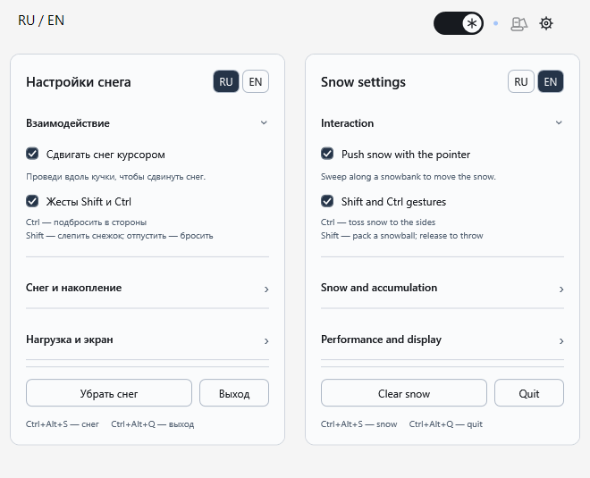

# Snow1970

Интерактивный снег для Windows 10 / 11: сугробы на рабочем столе и рамках окон, снежки и маленький экскаватор.



## Запуск

Скачайте [Snow1970.exe](Snow1970.exe?raw=true) и запустите. Установка, интернет и права администратора не нужны. Изображения уже встроены в готовую программу.

Для запуска из исходников скачайте весь репозиторий и откройте **Start.vbs** (без консоли) или **Start.cmd**. Нужен встроенный в Windows .NET Framework; сборка выполняется автоматически, без сторонних пакетов.

## Управление

- Свитч справа вверху включает снег. Панель находится на рабочем столе под окнами приложений.
- Цвет панели и настроек автоматически выбирается по фону под ними: черный или белый. Синий индикатор остается синим.
- Проведите курсором по снегу, чтобы сдвинуть его. Глубокие сугробы сопротивляются сильнее.
- **Ctrl** подбрасывает две порции в стороны; **Shift** собирает снежок, отпускание со взмахом бросает его.
- При скрытии окна снег падает с рамки. Брошенные комки разбиваются о границы, компактные куски слипаются.
- Экскаватор с подвижным ковшом собирает снег, увозит за экран и возвращается пустым.
- После заполнения участка появляются матовые снеговички и елочки. Плотность ограничена примерно двумя фигурками на ширину пяти ячеек значков.
- Снег на значках, взаимодействие курсора, жесты, фигурки и экстремальный снегопад настраиваются отдельно.
- **Ctrl+Alt+S** — включить/выключить снег; **Ctrl+Alt+Q** — выйти.

«Авто» и «Экономно» ограничивают число снежинок для слабых устройств. «Плавно» использует выбранную интенсивность. Частота вывода подстраивается под экран. При доступном ускорении снежинки выводятся через DirectComposition.

## Локальные данные

Программа не использует сеть. Для выбора темы локально считываются несколько точек возле интерфейса, которые сразу сводятся к яркости. Снимки экрана не создаются и не сохраняются. Для физики локально читается геометрия окон и, при включенной опции, значков.

Пользовательские настройки сохраняются в **Settings.ini** рядом с программой. Этот файл, логи и каталог **bin/** исключены из Git. **Settings.example.ini** содержит только общие настройки по умолчанию.

## Проверка и сборка

```powershell
$exe = .\Start.ps1 -BuildOnly
& $exe --self-test .\checks
& $exe --renderer-check .\checks
```

Нативные проверки предназначены для обычного сеанса Windows с рабочим столом Explorer. Проверки включают физику, сохранение массы, ограничения плотности, вывоз снега за экран, темы и прохождение кликов.

Графика снеговичков, елочек и экскаватора создана с помощью imagegen. Оформление элементов — нативная адаптация Spartan UI без браузерного движка.
